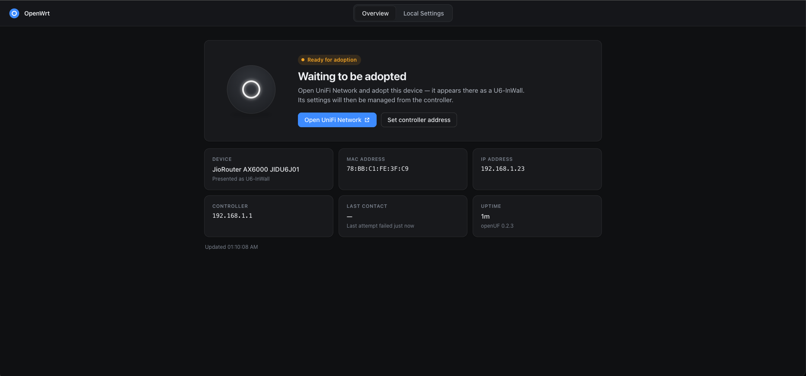
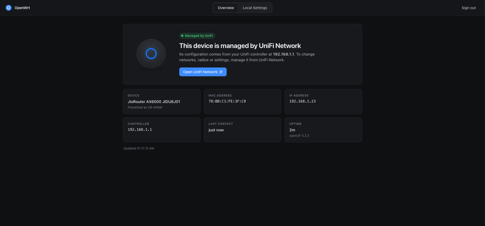
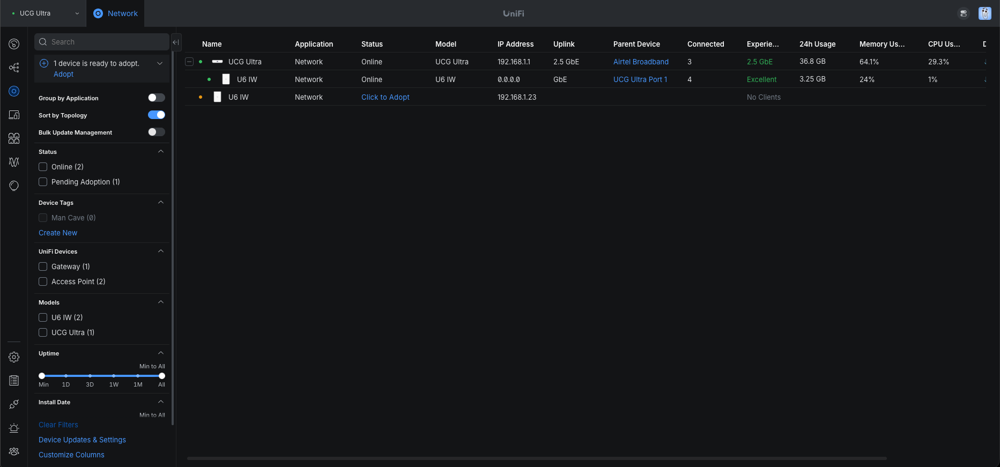
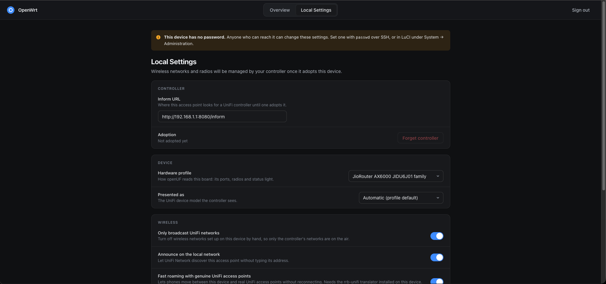
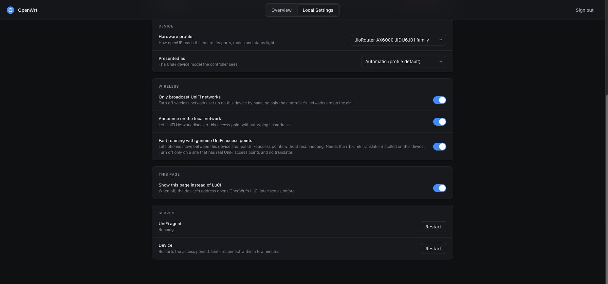
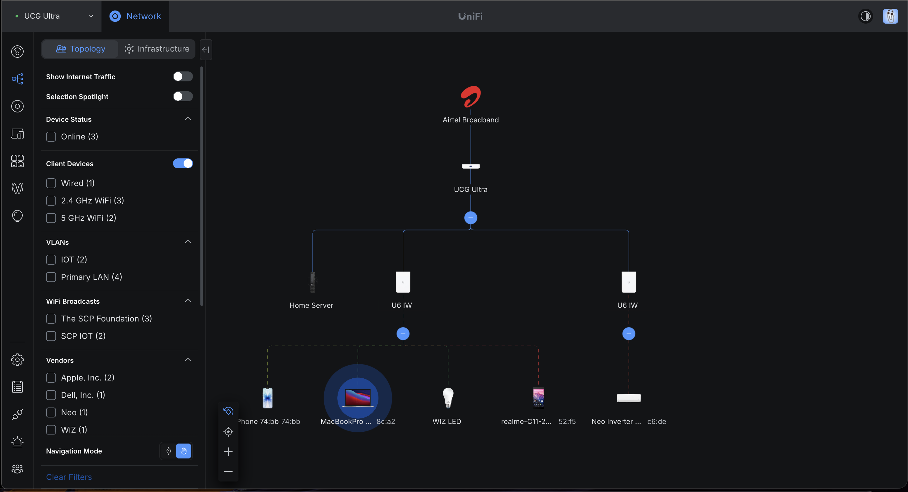

<p align="center">
  
</p>

<h1 align="center">openUF</h1>

<p align="center">
  <b>Run your OpenWrt access points from UniFi Network.</b><br>
  openUF makes an OpenWrt router look like a Ubiquiti access point to the UniFi controller:
  adopt it, push your WiFi networks to it, see its clients and radios, and mesh it with other
  openUF APs.
</p>

<p align="center">
  <a href="https://github.com/Fantastic792/openUF/actions/workflows/test.yml"></a>
  <a href="https://github.com/Fantastic792/openUF/releases"></a>
  <a href="LICENSE"></a>
  <a href="https://www.lua.org/"></a>
</p>

<p align="center">
  <a href="#install">Install</a> ·
  <a href="#using-it-with-unifi-network">Guide</a> ·
  <a href="#how-well-it-is-tested">Tested</a> ·
  <a href="#known-issues">Known issues</a> ·
  <a href="#hardware">Hardware</a> ·
  <a href="#contributing">Contributing</a> ·
  <a href="#credits">Credits</a>
</p>

---

**Status: beta.** openUF runs every day on two routers here and passes 1,588 unit tests and
an automated two-AP lab suite. It is still young: read [Known issues](#known-issues) before
you put it in front of people who depend on the WiFi. Not affiliated with Ubiquiti.

## What this is

UniFi Network manages Ubiquiti's own access points. openUF is a daemon for OpenWrt that
speaks the same protocol, so the controller adopts an OpenWrt router as if it were a
**U6 In-Wall** and manages it like one. It is for people who already run a UniFi controller
and want to use OpenWrt hardware they own, or hardware UniFi doesn't make, as access points
in the same site.

openUF is an access point only: no gateway or switch emulation, by design. How close it gets
to a real U6 In-Wall, feature by feature: [docs/U6IW-PARITY.md](docs/U6IW-PARITY.md).

**This repository is an independent fork.** openUF was started by
[trueserve](https://github.com/trueserve/openUF) in 2016, grew up as
[jonasevcik/openUF](https://github.com/jonasevcik/openUF), and this fork is built on
[yesrab/openUF](https://github.com/yesrab/openUF). It has its own releases, fixes and
testing, and is maintained by [Fantastic792](https://github.com/Fantastic792), who also
sends pull requests to yesrab/openUF. The upstream authors have not reviewed or endorsed this
fork. Much of its code was written with the help of an AI coding assistant, and every change
is reviewed and tested before it lands. [CREDITS.md](CREDITS.md) lists every project used and
what came from each.

## See it

The device's own page, before and after the controller adopts it:

| Waiting to be adopted | Managed by UniFi Network |
|:---:|:---:|
|  |  |

In UniFi Network it shows up as a U6 In-Wall and adopts with one click:



The few settings that stay on the device, behind the root password:

| Controller and hardware profile | Wireless, this page, service |
|:---:|:---:|
|  |  |

## Features

✅ tested on real hardware here · 🧪 tested in the VM lab only · ⚪ built, not yet validated
here (some have upstream's own results, [see below](#inherited-results-not-verified-here))

**Adoption and management**
- ✅ Discovery on the LAN (UniFi Network, the UniFi app, WiFiman) and one-click adoption
  through the same locked-down `ubnt` login a real AP has; adoption by inform URL across
  subnets
- ✅ Locate, client blocking, Forget and re-adopt, in-place upgrades
- ✅ A device page instead of LuCI's login, with LuCI one step away, a dashboard, the Halo
  theme, and a Setup page that turns a new router into an AP

**WiFi from the controller**
- ✅ WPA2, WPA3 (SAE) and Enhanced Open (OWE); private pre-shared keys, each on its own VLAN
- ✅ Band steering, minimum RSSI, load balance, per-client speed limits, WiFi Blackout
  Schedules, the multicast and broadcast blocker, the AP's name in the beacon
- ✅ VLAN per SSID, hidden SSIDs, channel, width and power per radio, 802.11r/k/v
- 🧪 WPA-Enterprise (802.1X) with the controller's RADIUS profile; Multicast Suppression
  (both modes)
- ⚪ Hotspot 2.0 / Passpoint, RADIUS MAC authentication and CoA/Disconnect, MAC-based VLANs
  (Virtual Network Override), Lock to AP, guest restrictions without the portal, SNMP
  monitoring, TDLS and Country IE, auto-channel limits, DFS radar reporting
- ⚪ New in 1.0.2: remote logging to the syslog server set in the controller (the plain
  kind; UniFi's encrypted logging is not supported); WPA2 networks no longer offer the extra
  `WPA-PSK-SHA256` mode that some older Apple devices refuse, matching a real UniFi AP
  (idea from [antoniocosta/unifi-openwrt](https://github.com/antoniocosta/unifi-openwrt))

**Guest network and uplink**
- ✅ The controller's guest portal: redirect, authorize, per-guest limits
- ✅ Uplink Connectivity Monitor: SSIDs off when the uplink stops answering, back when it
  returns

**Mesh and roaming**
- ✅ One-hop mesh: the AP switches to a wireless uplink when its cable goes and back when it
  returns, with a loop guard; cold boot without a cable
- 🧪 Multi-hop mesh
- ✅ Fast roaming (802.11r) between openUF APs
- ⚪ Fast roaming to and from genuine UniFi APs, through
  [d-malinowski's rrb-unifi translator](https://github.com/d-malinowski/unifi-openwrt-roaming)

**Statistics**
- ✅ Clients with WiFi Experience, radios and channel use, the uplink, wired hosts per port,
  neighbouring APs and RF scans
- ⚪ New in 1.0.2: each client's channel width (20/40/80/160 MHz) in the client panel,
  which showed 20 MHz for everyone before

**Install**
- ✅ Pure Lua 5.1, no toolchain: one command installs it on OpenWrt 25.12 as packages or as
  files; ⚪ OpenWrt 24.10 with `opkg`

## How it works

openUF runs beside OpenWrt's own services and drives them; it does not replace them.

1. **Announce.** It sends the discovery packets a UniFi AP sends, presenting a U6 In-Wall
   identity, so the controller and the UniFi app see a device waiting to be adopted.
2. **Inform.** Like a real AP it reports to the controller every few seconds over the inform
   protocol (HTTP, AES-encrypted with the device's key after adoption) and carries out the
   commands in each reply.
3. **Translate.** The controller's configuration (WLANs, radios, VLANs, guest rules, mesh)
   becomes OpenWrt UCI, hostapd and nftables settings, applied with the least disruption it
   can manage. A per-board hardware profile maps the controller's ports and radios onto the
   router's.
4. **Report.** Clients, radios, neighbours and the uplink are read from hostapd, `iw` and the
   kernel and sent back in the controller's own format.

## Install

One command on the device, over SSH:

```sh
wget -qO- https://raw.githubusercontent.com/Fantastic792/openUF/main/setup.sh | sh
```

The guided installer identifies the board, asks the few things it cannot know, and does
the rest in an order that never leaves the device unreachable:

1. **Interview.** Every question first. The default installs the `openuf` and
   `luci-app-openuf` packages from this project's latest release, plus the Halo theme where
   there is room; `--headless` installs the daemon alone.
2. **Access-point conversion.** The router role goes: no WAN, the WAN socket joins the LAN,
   DHCP server and firewall off. Everything is left installed and is one command to undo.
3. **Hardware profile**, **controller address** and the **adoption account**, which locks
   itself once the device is adopted.
4. **Dependencies**, including the full `wpad` build, then install and reboot.

Unattended, with every answer as an option (`sh setup.sh --help` lists them):

```sh
wget -qO- https://raw.githubusercontent.com/Fantastic792/openUF/main/setup.sh | sh -s -- \
    --yes --controller 10.0.0.5 --modelmap jiorouter-ax6000-jidu6j01 --no-reboot
```

The packages alone, from the [release page](https://github.com/Fantastic792/openUF/releases):

```sh
apk add --allow-untrusted ./openuf-<ver>.apk ./luci-app-openuf-<ver>.apk   # OpenWrt 25.12
opkg install ./openuf_<ver>_all.ipk ./luci-app-openuf_<ver>_all.ipk         # OpenWrt 24.10
openuf deps --install        # swaps a wpad-basic build for the full one
```

Or from the signed apk feed (OpenWrt 25.12), so `apk upgrade` brings each release:

```sh
wget -O /etc/apk/keys/openuf-feed.pem https://raw.githubusercontent.com/Fantastic792/openUF/main/keys/openuf-feed.pem
echo https://fantastic792.github.io/openUF/apk/packages.adb > /etc/apk/repositories.d/openuf.list
apk update && apk add openuf luci-app-openuf
```

Later releases: `apk update && apk upgrade`. If `apk update` says `WARNING: updating and
opening ...openuf...: UNTRUSTED signature`, the key is not in `/etc/apk/keys/`.

Upgrade with `openuf-update` on the device, or by installing the next release's packages.
Install the packages or the files, never both. The [usage guide](USAGE.md) covers every
option, the device page, upgrading, uninstalling and troubleshooting.

## Using it with UniFi Network

What running openUF against UniFi Network 10.6 has taught this project, in the order you
meet it.

**Adopting**
- On the same LAN the AP appears under Devices; click **Adopt**. On another subnet, point
  it at the controller first:
  `ssh root@<ap> 'syswrapper.sh set-inform http://<controller>:8080/inform'`
  (use your controller's inform port if you changed it from 8080). It then shows as
  *Pending*.
- After a **Forget**, wait for the AP to report in once before sending `set-inform` again;
  one sent too early is overwritten (see [Known issues](#known-issues)).
- **Name each device** in the controller. The name is what the beacon advertises; a device
  never named advertises `openUF`.

**WiFi settings**
- **Minimum RSSI** goes up to -67 dBm in the UI. openUF disconnects a client after 30 s
  below it and refuses it on that radio until it is 3 dB above.
- **Load balance** has no switch in Network 10.6's UI. It can be set through the
  controller's API on the device's `radio_table` (`loadbalance_enabled`, `maxsta`).
- **Multicast Suppression** (the old multicast and broadcast blocker): *Aggressive* blocks
  group traffic toward clients except ARP, neighbour discovery and DHCP, and except
  senders on its allow-list; *Conservative* only rate-limits it (100 packets/s, openUF's own
  figure). A controller too old to send the ARP/DHCP bypass gets the strict blocker: then put
  your DHCP server's MAC on the allow-list, or wireless clients get no address.
- **Band steering** comes from the network's toggle or the device's own setting (Off /
  Prefer 5G). Balance is not supported.
- **Airtime Fairness:** set it On for the device after adoption; the controller can hold an
  old Off and push it.
- **Per-port VLANs:** turn on **Port VLAN** in the device's settings first, then set a
  port's Native VLAN. On DSA boards (most WiFi 6 routers) only the native VLAN is applied.
- **WPA-Enterprise (802.1X)** works with a RADIUS profile on the WLAN. Use one port and one
  shared secret for all of a profile's servers (OpenWrt has one of each per WLAN), plain RADIUS
  rather than RadSec, and a full `wpad` build. A RADIUS-assigned VLAN only works for VLANs the
  AP already carries.
- **A client's Virtual Network Override** (MAC-based VLAN, set on the client's page) puts it
  on that network's VLAN on any SSID. The controller only sends it when the site has a UniFi
  gateway and every AP and switch in the site supports it, so one older AP turns it off
  everywhere. The override network must be a corporate network.

**Mesh**
- Turn on **Wireless Meshing** for every AP that should take part. The wired AP then offers
  a hidden mesh network; an AP whose cable goes switches to it about 16 s later and is back
  on the controller within about 25 s, then returns to the cable within a second of it
  coming back. A cabled AP keeps its mesh station even though the controller only sends it
  the mesh name and key.
- The Uplink Connectivity Monitor is on by default in new sites. An AP with no way out takes
  its SSIDs off the air after about 50 s, so clients move elsewhere.

**Checking an AP**
- `sh tools/selfcheck.sh` (from the source tree, copied over with `scp -O`) checks every
  feature the controller has turned on and prints OK, FAIL or SKIP for each.
- `logread | grep -E 'openuf|backhaul|uplinkmon'` shows what openUF did and why.

## How well it is tested

Only what this project has tested itself is marked tested. Lab VMs have simulated radios, no
switch chip and no PoE, so a lab pass is not a hardware pass.

**Unit tests:** 1,588 pure-Lua tests run on every push (see the badge), with the packaging
tests, an end-to-end adoption simulation and the field-report checks.

**VM lab:** three OpenWrt 25.12 VMs on a simulated WiFi medium and a UniFi Network 10.6.106
controller in Docker. An automated suite (`labtest/`) adopts two APs, pushes settings from the
controller and checks the result on the device and over the air: one AP (16 checks), two APs
with roaming and mesh (8 checks), and a table that changes each controller setting and puts
it back.

**Real hardware:** two **JioRouter AX6000 JIDU6401** units on OpenWrt 25.12.6, managed by a
self-hosted UniFi Network 10.6.106 with no UniFi gateway, 2026-10-27 to 2026-10-29. One unit
wired, the other on a cable or the mesh. Clients: an iPhone, a Samsung Galaxy S22 and a wired
PC. The full record:
[field-reports/2026-10-29-jiorouter-jidu6401-fantastic792.toml](field-reports/2026-10-29-jiorouter-jidu6401-fantastic792.toml).

| Feature | Result |
|---|---|
| Install and upgrade | ✅ 0.1.0 to 0.1.3 with `apk`; the upgrade restarts openUF and the translator |
| Adoption | ✅ Found on the LAN and adopted; Forget and adopt again (see Known issues) |
| WPA3 (SAE) | ✅ Both phones; WPA3 kept after adoption |
| Enhanced Open (OWE) | ✅ A phone joined with OWE |
| Private pre-shared keys | ✅ Two phones, each on its key's VLAN, also after the SSID went off and on |
| Fast roaming between the two units | ✅ iPhone with FT-SAE, one lost ping per roam, both ways. The S22 does not use FT and roamed with a full reconnect (1.5 to 1.8 s) |
| Band steering | ✅ On: a phone on 2.4 GHz was asked to move to 5 GHz about a minute later and accepted. Off: no request in 3 minutes |
| Minimum RSSI | ✅ At -67 dBm a phone walking away was disconnected 44 s after falling below, and refused until it came back |
| Load balance | ✅ With a cap of 1, the more idle of two phones was disconnected 11 s after the second joined |
| Speed limit | ✅ 5 / 2 Mbps measured as 4.69 / 1.80 Mbps; 92 / 92 Mbps without |
| WiFi Blackout Schedule | ✅ Off and on within about 15 s of the times, mesh link untouched |
| Multicast and broadcast blocker | ✅ A host not on the exception list could not reach a phone; listed, it could; DHCP kept working |
| AP name in the beacon | ✅ The controller's device name in both units' beacons, no WPS prompt (unnamed devices: Known issues) |
| Locate | ✅ The LED blinked and stopped |
| Guest portal | ✅ Redirected to the hotspot page, let through once authorized |
| Uplink Connectivity Monitor | ✅ SSIDs off about 50 s after the uplink stopped answering, back about 5 s after |
| Mesh, one hop | ✅ Cable pulled: station on at 16 s, joined at 20 s, controller reached at 24 s. Back on the cable 1 s after it returned. No loop in any run |
| Mesh, cold boot without a cable | ✅ Came up on the mesh |
| Clock after a reboot | ✅ Booted 4 to 6 minutes slow; corrected within about 2 minutes |
| `selfcheck.sh` | ✅ No failures on either unit |
| Per-port VLANs | ⏳ Started: the port moves to its VLAN's bridge; client test not finished |

**Not run here yet:** fast roaming with a genuine UniFi AP, multi-hop mesh on hardware,
Airtime Fairness measured, OpenWrt 24.10, any other board, a UniFi gateway, and a run longer
than a few hours. The upstream projects' results for some of these are
[below](#inherited-results-not-verified-here).

## Known issues

**Fixed in 1.0.2** (upgrade if you run an older one; [release notes](docs/release-notes/1.0.2.md)):

- **The install command stopped on a fresh OpenWrt 25.12 router**, first at "download
  failed" (its download tool gets no answer from github.com) and then at "not signed by the
  openUF release key" (it has no `openssl` to check the signature with), and on images
  with `iw-full` at "required and could not be installed: iw". The installer now fetches
  through GitHub's API address, adds `openssl-util` from OpenWrt's own feed and accepts
  `iw-full`. The whole install passed in the VM lab on stock OpenWrt 25.12.6.
- **`openuf deps` was broken since 1.0.0** (a "syntax error"), so the dependency page could
  neither report nor install missing packages.
- **A MAC filter with no addresses yet stopped every WiFi change** on that AP. It now
  applies, and with an empty allow list nobody joins that network, as on a UniFi AP.

**Fixed in 1.0.1** (upgrade if you run 1.0.0; [release notes](docs/release-notes/1.0.1.md)):

- **Compressed controller replies could exhaust memory.** A crafted reply of about 8 KB
  could make openUF use about 160 MB of RAM and take down an AP with 128 MB. Sending one
  needs the device's key, which before adoption is the public default key. openUF now
  refuses any reply that unpacks to more than 1 MiB, far more than a real one.
- **Guest rules missing on a guest WLAN without an id.** When the controller sent a guest
  WLAN without its id, the guest firewall rules were not installed. openUF now matches such
  a WLAN by its name.

**Open findings from this project's lab and code audit:**

- **Four settings in the lab's change-and-restore table** (disable a device, mesh station
  off, network enable, port security) do not restore cleanly. Some look like
  test-side problems; port security needs real switch ports to check.
- The file-by-file audit is about a third of the way through the core files. Findings are
  fixed or listed here before a release.

**Found in testing on hardware:**

- **A new neighbour reloads WiFi once.** The first time an AP sees a neighbour's radio, it
  asks the controller for its whole configuration, and that push reloads its WiFi: clients
  drop once. It stops once the APs have seen each other. openUF also takes another openUF AP
  for a UniFi AP.
- **AP name and hostname.** A device not named in the controller beacons `openUF`, because
  the controller sends no name for it. WiFiman shows the router's hostname, which openUF does
  not yet set from the controller's name.
- **Silent disconnects.** Minimum RSSI and load balance disconnect clients without a log line.
- **Re-adoption.** After a Forget, a `set-inform` sent while the reset's own one is pending
  is overwritten, and the `ubnt` account is locked only when openUF next restarts.
- **Mesh switch time.** The station comes up 15 to 16 s after the cable goes, not the 10 s
  the code waits, when a report to the controller is already in flight.
- **DFS channels under country India.** Linux's regulatory database gives India no DFS
  region, and the kernel then refuses the radar check on every driver, so channels 52-144
  cannot be used in a site set to India. The JioRouter profiles keep DFS out for this
  reason; whether the MT7986 runs DFS under another country is not yet checked.

## Hardware

Any dual-band OpenWrt device with **16 MB of flash or more** and about 5 MB free on
`/overlay` (the AES-GCM crypto the controller insists on needs `libopenssl3`). A **full
`wpad` build** is required and the installer swaps it in.

| Board | Profile | Tested here |
|---|---|---|
| JioRouter AX6000 JIDU6J01 family (JIDU6J01, 6201, 6401, 6601, 6701) | `jiorouter-ax6000-jidu6j01` | ✅ JIDU6401, see above. DFS channels are left out on purpose: the radar check failed when tested, under country India, where no Linux AP can run one (see Known issues) |
| JioRouter AX6000 JIDU6101 | `jiorouter-ax6000-jidu6101` | Not here; [inherited](#inherited-results-not-verified-here) |
| TP-Link Archer C5 v1 | `archer-c5-v1` | Not here; inherited |
| TP-Link TL-WDR3500 v1 | `tl-wdr3500-v1` | Not here; inherited (8 MB flash, needs an image with the crypto built in) |
| TP-Link Deco M4R v1 / v2 | `deco-m4r-v1` | Not here; inherited |
| Xiaomi Mi Router AX3000T | `xiaomi-ax3000t` | Not here; inherited |
| BT Home Hub 5 Type A | `bt-homehub-v5a` | Not here; [inherited](#inherited-results-not-verified-here) (adopted on 25.12.6 by a jonasevcik/openUF contributor) |
| TP-Link Archer A7 v5 / C7 v4 / C7 v5, Deco M5 v1-v3, Deco M4R v4, Dynalink DL-WRX36 | from the OpenWrt sources | Never run on the board |
| TP-Link WR1043ND v2 | `tl-wr1043ndv2` | Single band; profile only |

Anything else runs on a generic dual-band or single-band profile, or on one the installer
generates from the running device. Each profile's details are in
[REFERENCE.md § Supported hardware](REFERENCE.md#supported-hardware). A board you have
tested belongs in a [field report](field-reports/README.md).

## Documentation

| Document | What it is for |
|---|---|
| [USAGE.md](USAGE.md) | Installing by hand, every configuration option, the device page and LuCI app, upgrading, troubleshooting |
| [REFERENCE.md](REFERENCE.md) | Every feature with its implementation status, the hardware matrix, local testing and protocol notes. Its status column is largely the upstream projects' |
| [PROTOCOL-VALIDATION.md](PROTOCOL-VALIDATION.md) | What was confirmed against a live controller, with the wire evidence; it wins where other documents disagree |
| [REVERSE-ENGINEERING.md](REVERSE-ENGINEERING.md) | What is not implemented yet, what is known about it, and the experiment plan |
| [PACKAGING.md](PACKAGING.md) | The OpenWrt packages, the LuCI app, the theme and the release workflow |
| [docs/PLUGINS.md](docs/PLUGINS.md) | The opt-in hook for third-party edits to each WLAN's options |
| [field-reports/](field-reports/README.md) | Hardware test results, and how to send yours |
| [docs/release-notes/](docs/release-notes/) | What changed in each release, in plain words |
| [CREDITS.md](CREDITS.md) | Every project openUF used, and what came from each |
| [CLAUDE.md](CLAUDE.md) | Working notes for contributors: the constraints and the landmines |

## Contributing

Issues and pull requests are welcome at [github.com/Fantastic792/openUF](https://github.com/Fantastic792/openUF).

**Send a field report.** The most useful contribution: test a feature on your hardware and
send the result in the [field-report format](field-reports/README.md), as a pull request
with one TOML file or through the **Field report** issue form. A failure is as useful as a
pass. `python3 tools/field_report.py check <file>` validates it before you send it.

**Report a problem** with the board and OpenWrt version, the controller version, and the
output of `openuf status` and `logread -e openuf` on the device. Say what the controller
showed. Leave out passwords, WiFi keys and public addresses.

**Add a hardware profile.** On a DSA board the installer can generate one (`setup.sh`, or
*Export* on the LuCI settings page); otherwise write `openuf/modelmap/<vendor>-<model>.lua`
from the board's OpenWrt DTS and `board.d` entry, following
[the device-map guide](.claude/skills/add-device-map/SKILL.md), and say in its
header what was and was not confirmed on the hardware.

**Change the code.** The daemon is Lua 5.1 as OpenWrt ships it, the installers are POSIX
shell for busybox; the constraints are listed in [CLAUDE.md](CLAUDE.md). Before a pull
request:

```sh
eval $(luarocks path --local) && lua tests/run_tests.lua   # the suite, pure Lua, no hardware
bash -n setup.sh && dash -n setup.sh                         # both shells, for every script touched
sh tools/dist.sh --verify                                    # the stripped tree is bytecode-identical and still passes
```

A new test file is registered in `tests/run_tests.lua`. Comments explain *why*, naming the
failure that motivated the code. Where a fact cannot be determined, report nothing rather
than a plausible guess. Protocol changes start from PROTOCOL-VALIDATION.md. No device
addresses, passwords or controller keys go into the tree. CI runs the suite, the release
verification and the field-report check on every push.

**Test without hardware.** `sh tools/simulate.sh --adopt` runs an adoption round-trip against
the Python controller stub; `tools/validation/` has a Docker UniFi controller for the real
thing.

## Credits

openUF exists because of the people who built it before this fork:
[trueserve](https://github.com/trueserve/openUF) started it,
[Jonas Sevcik](https://github.com/jonasevcik/openUF) built most of the daemon, and
[yesrab](https://github.com/yesrab/openUF) added the packages, the LuCI app and theme, and
the plugin system this fork is built on. Features were also ported from
[fonix232/openUF](https://github.com/fonix232/openUF) and
[d-malinowski/openUF](https://github.com/d-malinowski/openUF), and fast roaming with genuine
UniFi APs uses
[d-malinowski/unifi-openwrt-roaming](https://github.com/d-malinowski/unifi-openwrt-roaming).
The protocol groundwork came from [amd989/unifi-gateway](https://github.com/amd989/unifi-gateway),
[jeffreykog/unifi-inform-protocol](https://github.com/jeffreykog/unifi-inform-protocol) and
[fxkr/unifi-protocol-reverse-engineering](https://github.com/fxkr/unifi-protocol-reverse-engineering).
Built on [OpenWrt](https://openwrt.org/) and [LuCI](https://github.com/openwrt/luci).

**[CREDITS.md](CREDITS.md)** has the details: what came from each project (with commits),
what was only read, and the tools used in testing. Something missing or wrong there? Open an
issue.

## License

[GPL-3.0-or-later](LICENSE). [NOTICE](NOTICE) lists the copyright holders and preserves the
MIT notice of the earlier openUF work. `luci-theme-halo` is Apache-2.0.

UniFi is a trademark of Ubiquiti Inc. This project is not affiliated with or endorsed by
Ubiquiti.

---

## What this fork changed

Compared with [yesrab/openUF](https://github.com/yesrab/openUF) `main` at `6277bdf`
(2026-10-26), the point this fork started from. Later yesrab fixes are merged in by hand.

| Area | Before | Now |
|---|---|---|
| Mesh | One hop | Several hops, with the loop guard and the controller's parent choice; a downlink beacons its path element even with no uplink station |
| Mesh station on a cabled AP | A cabled AP whose "Allow meshing to another access point" is off still joined the mesh when its cable went: the station was built even when the controller sent none | Built only when the controller sends the station entry (the switch is on); an AP on its mesh uplink keeps it |
| Mesh failover time | Checked once per report, after two failed ones: 39 s to 98 s | The cable is read every second; the station comes up 10 to 16 s after it goes |
| Mesh failback (DSA) | A device that crossed the wireless link could stay unreachable from other ports until a reboot | The switch entries left behind are rewritten |
| Mesh child's SSIDs after a WiFi reload | The AP on the station's radio could stay up but silent until a reboot | Its beacon is restarted after two silent heartbeats |
| Clock after a reboot | A clock wrong at boot could stay wrong for hours, and fast roaming then failed | Time sync is restarted when the controller's clock disagrees by more than a minute |
| Uplink Connectivity Monitor | — | New |
| Guest portal | — | New, from [jonasevcik/openUF](https://github.com/jonasevcik/openUF): redirect, authorize, per-guest limits, offline mode, disconnect when authorization ends |
| AP name in the beacon | The toggle had no effect | The name is in the beacon |
| WPA3 and Enhanced Open | The controller's first push after adoption downgraded them | Kept |
| Private pre-shared keys | A key's VLAN was lost when its SSID went off and on | Comes back with the SSID |
| Load balance | Could kick a mesh child | Leaves the mesh link alone |
| Guest WLAN | Read as a mesh link | An ordinary AP |
| Multicast and broadcast blocker | Built once | Rebuilt when the live SSIDs change |
| Multicast Suppression | Conservative pushed nothing; Aggressive came without its ARP/DHCP bypass | Both modes, from [jonasevcik/openUF](https://github.com/jonasevcik/openUF) |
| MAC-based VLANs (Virtual Network Override) | Not claimed, so one openUF AP turned the feature off for the whole site | Claimed and applied through hostapd's accept-MAC list, from [jonasevcik/openUF](https://github.com/jonasevcik/openUF) |
| TDLS, the Country IE and the pairwise cipher | Sent by the controller and dropped | Applied; the cipher only where the radio supports it, and the Country IE kept on for 5 GHz, where turning it off takes the radio down; from [jonasevcik/openUF](https://github.com/jonasevcik/openUF) |
| Discovery replies (UniFi app, WiFiman) | Only some requests answered, by broadcast or unicast | Also the UniFi gateway's multicast probes and the MAC-addressed probe, rate-limited per asker; from [jonasevcik/openUF](https://github.com/jonasevcik/openUF) |
| Plugins | — | An opt-in hook for third-party edits to each WLAN's options ([docs/PLUGINS.md](docs/PLUGINS.md)), off by default; from [jonasevcik/openUF](https://github.com/jonasevcik/openUF) |
| WPA-Enterprise (802.1X) | Skipped: the WLAN was never provisioned | Provisioned with the RADIUS servers the controller sends, from [jonasevcik/openUF](https://github.com/jonasevcik/openUF) |
| WPA3 station keys (`sae_psk`) | Sent by the controller and dropped | Each key on its own station entry, MAC-bound where the controller binds it; from [jonasevcik/openUF](https://github.com/jonasevcik/openUF) |
| SAE tuning (anti-clogging, sync time, groups) | Sent by the controller and dropped | Applied on WPA3 and WPA2/WPA3 WLANs, from [jonasevcik/openUF](https://github.com/jonasevcik/openUF) |
| Guest walled garden | Its address entries were dropped as unrecognised and its domains ignored | Both halves enforced, domains resolved on the AP every ten minutes; from [jonasevcik/openUF](https://github.com/jonasevcik/openUF) |
| Guest WLAN without the portal | Its guest rules were not enforced | Restricted subnets and restricted DNS enforced with the portal off or without a URL; from [fonix232/openUF](https://github.com/fonix232/openUF), lab-unvalidated |
| Hotspot 2.0 / Passpoint | A Passpoint WLAN could not be saved for this AP | Provisioned with its ANQP profile where hostapd can serve it, from [jonasevcik/openUF](https://github.com/jonasevcik/openUF); HESSID, ANQP domain and QoS map from [fonix232/openUF](https://github.com/fonix232/openUF) |
| RADIUS MAC authentication, CoA/Disconnect | Not applied: a MAC-authenticated WLAN was open to everyone | Each MAC checked against the RADIUS server, and the server can disconnect a client; from [jonasevcik/openUF](https://github.com/jonasevcik/openUF), with the Dynamic Authorization relay from [fonix232/openUF](https://github.com/fonix232/openUF) |
| SNMP monitoring | — | The controller's SNMP settings applied to OpenWrt's snmpd, opt-in; from [fonix232/openUF](https://github.com/fonix232/openUF) |
| Lock to AP | The site feature was refused while an openUF AP was in it | Claimed and enforced; from [fonix232/openUF](https://github.com/fonix232/openUF) |
| Auto-channel limits | The site's DFS switch and channel blacklist were never sent to the AP | Applied to hostapd's auto-channel; a board profile's DFS exclusion still wins; from [jonasevcik/openUF](https://github.com/jonasevcik/openUF) |
| DFS radar | A radar hit moved the radio off its channel, the controller logged nothing, and nothing ever moved it back | Reported to the controller as the AP's radar event, and the controller's nightly `dfs-reset` puts a pinned radio back; from [jonasevcik/openUF](https://github.com/jonasevcik/openUF) |
| STUN | Never looked the controller's name up again | Looks it up again after 3 unanswered requests |
| Package upgrade | Left the old daemon running | Restarts openUF and the translator |
| LuCI | — | A Setup page for a new router |
| Tools | — | `tools/selfcheck.sh`, `tools/verify.py`, field reports with `tools/field_report.py`, and the VM lab suite in `labtest/` |

## Inherited results, not verified here

The upstream projects ([yesrab/openUF](https://github.com/yesrab/openUF) and, before it,
[jonasevcik/openUF](https://github.com/jonasevcik/openUF)) reported the results below on
their own hardware. This fork has changed a lot since (the table above), and **has not
re-run these tests on its current code**. They are probably still true, but they are not
verified. If you can run any of them, please send a [field report](field-reports/README.md):
a pull request with one TOML file, or the **Field report** issue form. A confirmed result
moves up into [How well it is tested](#how-well-it-is-tested) with your name on it.

| Result reported by an upstream project | Field-report id |
|---|---|
| The core validated on real hardware against a **UniFi Cloud Gateway Ultra** on UniFi Network 10.x | `adoption`, `statistics` |
| **Fast roaming between openUF and a genuine UniFi AP** through the 802.11r translator | `ft-unifi` |
| **Per-port VLANs** on a Xiaomi AX3000T against a UCG Ultra, with a client getting its address on the assigned VLAN | `port-vlan` |
| **VLAN-tagged SSIDs**, end to end with a client on a tagged IoT network | `vlan-ssid` |
| **Airtime Fairness** On, pushed by a UCG Ultra and read back on four radios (ath10k, ath9k, two mt76) | `airtime-fairness` |
| **IoT Optimization: Force WiFi 4 Mode**, end to end | `radio-settings` |
| **Mesh** on a TP-Link Deco M4R v1, adopted and meshed by a user | `mesh-one-hop`, `board-profile` |
| **TP-Link Archer C5 v1** confirmed end to end, the reference device | `board-profile` |
| **TP-Link TL-WDR3500 v1** confirmed, with a custom image | `board-profile` |
| **BT Home Hub 5 Type A** (lantiq xrx200, DSA): adoption, the WiFi push and live clients on OpenWrt 25.12.6 against a UCG Ultra; `install.sh`, radio settings and Locate not confirmed; VLAN-tagged SSIDs build on `lan1`, so they assume the uplink cable is in `lan1` | `board-profile` |
| **JioRouter AX6000 JIDU6101**, the original lab APs | `board-profile` |
| **Xiaomi Mi Router AX3000T** confirmed, WiFi 6 | `board-profile` |
| **OpenWrt 24.10** with `opkg` | `openwrt-24.10` |
| **Multicast Suppression** from jonasevcik/openUF: both modes captured on the wire and the nft rules accepted by a real nft. This fork has since run all three modes over simulated WiFi in its VM lab (see [PROTOCOL-VALIDATION](PROTOCOL-VALIDATION.md#multicast-suppression-jonasevcik-f46cf36-2026-10-27)); not yet on a real radio | `blocker` |
| **TDLS and the Country IE** from jonasevcik/openUF: written into UCI and hostapd on two APs by a real push; the **pairwise cipher** probe read on two boards (one 5 GHz radio reports CCMP only) | `radio-settings` |
| **Hotspot 2.0 / Passpoint** from jonasevcik/openUF: wire captured and the generated config parsed by a real hostapd; no Passpoint client has associated | `passpoint` |
| **WPA-Enterprise** from jonasevcik/openUF: their lab push replayed end to end; this fork's VM lab has had a client log in with PEAP against FreeRADIUS. Not yet on a real radio | `wpa-enterprise` |
| **DFS radar event** from jonasevcik/openUF: the controller's handler accepted it and refused a copy without its channel; no live radar hit captured | `dfs` |
| **MAC-based VLANs** from jonasevcik/openUF: the push captured on a live controller with a UCG Ultra, and the accept file, VLAN section and live hostapd confirmed on two APs; no real client has been moved to a VLAN by MAC | `mac-vlan` |
| The feature-by-feature status in [REFERENCE.md](REFERENCE.md) and the evidence in [PROTOCOL-VALIDATION.md](PROTOCOL-VALIDATION.md), except where this README's own results cover it | any |

An upstream project's topology view, two openUF APs beside a UniFi Cloud Gateway Ultra:


