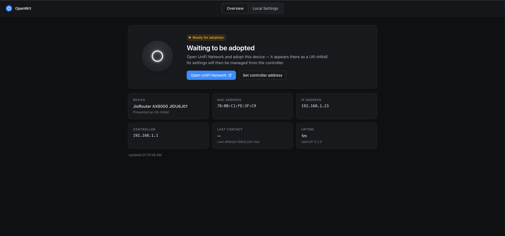
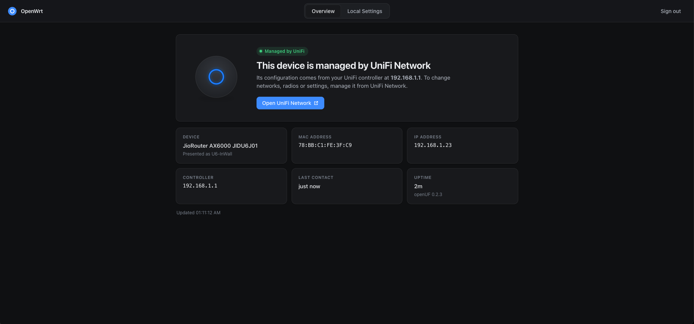
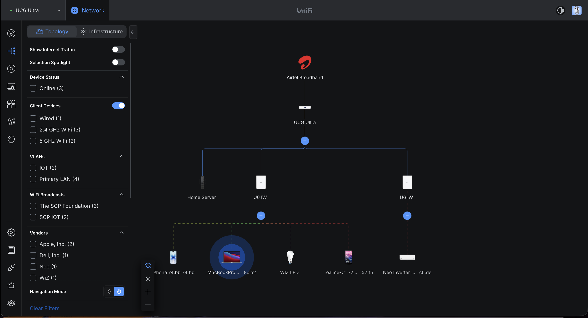
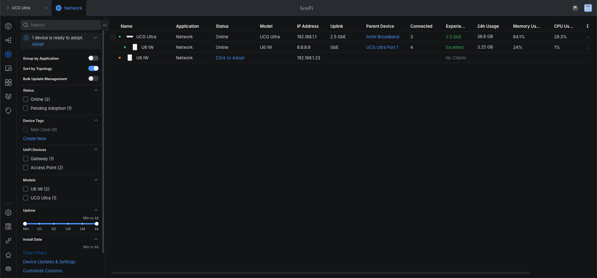
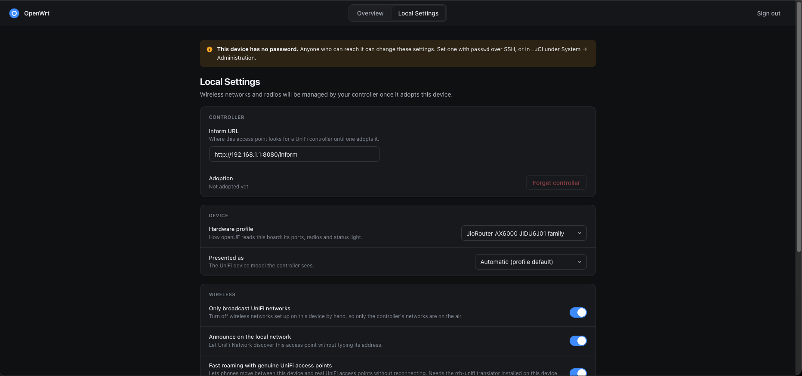
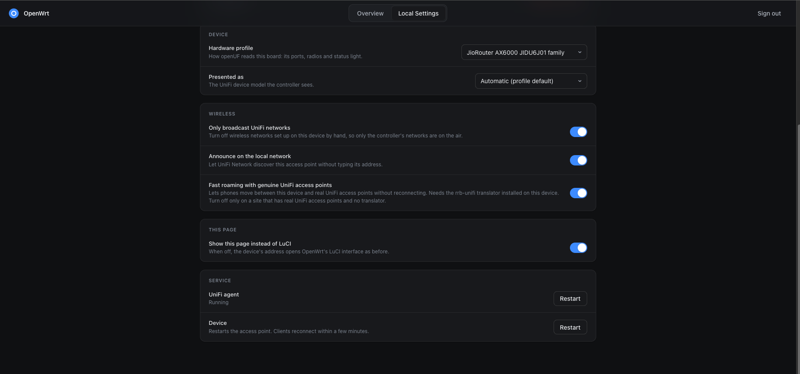

<p align="center">
  
</p>

<h1 align="center">openUF</h1>

<p align="center">
  <b>Run your OpenWrt access points from UniFi Network.</b><br>
  openUF makes an OpenWrt device look like a Ubiquiti access point to the UniFi controller:
  adopt it, push your WiFi networks to it, watch its clients, and roam between it and real UniFi APs.
</p>

<p align="center">
  <a href="https://github.com/Fantastic792/openUF/actions/workflows/test.yml"></a>
  <a href="https://github.com/Fantastic792/openUF/releases"></a>
  <a href="LICENSE"></a>
  <a href="https://www.lua.org/"></a>
</p>

<p align="center">
  <a href="#install">Install</a> ·
  <a href="#what-it-does">What it does</a> ·
  <a href="#this-fork">This fork</a> ·
  <a href="#hardware">Hardware</a> ·
  <a href="#documentation">Documentation</a> ·
  <a href="#contributing">Contributing</a> ·
  <a href="REFERENCE.md">Full reference</a>
</p>

---

## See it

The device's own page, before and after the controller adopts it:

| Waiting to be adopted | Managed by UniFi Network |
|:---:|:---:|
|  |  |

Two openUF access points, the **U6 IW** nodes, in a real UniFi Network topology beside a
UniFi Cloud Gateway Ultra, serving phones, laptops and IoT devices on two WiFi networks:



It shows up in UniFi Network as a U6 In-Wall and adopts with one click:



The few settings that stay on the device, behind the root password:

| Controller and hardware profile | Wireless, this page, service |
|:---:|:---:|
|  |  |

## What it does

- **Adoption like real hardware.** The AP announces itself on the LAN, appears in UniFi
  Network, WiFiman and the UniFi app, and adopts with one click through the same locked-down
  `ubnt` login the controller expects. A controller on another subnet adopts it by inform
  URL instead, with no SSH at all.
- **WiFi from the controller.** Networks with WPA2, WPA3 and Enhanced Open, per-network
  VLANs, private pre-shared keys, hidden SSIDs, channel, width and power per radio,
  802.11r/k/v, band steering, minimum RSSI, per-client speed limits, WiFi schedules, the
  multicast and broadcast blocker, the access point's name in the beacon, client blocking and
  Locate.
- **Hotspot and uplink checks.** The controller's guest portal: guests are sent to its
  hotspot page and held until they log in. The Uplink Connectivity Monitor takes the WiFi
  networks off the air when the uplink stops answering, so clients move to an AP that still
  has a way out.
- **Fast roaming with genuine UniFi APs.** The built-in translator speaks UniFi's 802.11r
  key exchange, so phones move between openUF and real UniFi access points without a
  reconnect.
- **Live statistics.** Clients with WiFi Experience scores, radios and channel utilisation,
  wired hosts per port, the uplink, neighbouring access points and RF scans.
- **Switch ports and mesh.** Per-port VLANs from the controller's Port settings, and a
  wireless uplink to another openUF AP when the cable is out, across several hops, with the
  loop guard keeping an AP from hanging off its own descendant.
- **A device page instead of LuCI's login.** Like a Ubiquiti device, the AP's address shows
  its status and sends you to the controller; LuCI stays one hidden step away, with a
  dashboard, the matching Halo theme, and a Setup page that walks a new router through its
  profile, the packages it needs, the controller, region and access-point mode.
- **Pure Lua, no toolchain.** One command installs it on OpenWrt 24.10 or 25.12, as packages
  or as files, with upgrades in place.

The core was validated on real hardware against a UniFi Cloud Gateway Ultra on UniFi
Network 10.x. The latest full run, every feature above together, was in a virtual machine on
OpenWrt 25.12.6 with UniFi Network 10.6.106 on 2026-10-27, fast roaming included (openUF to
openUF through the translator; the roam to a genuine UniFi AP is the original authors'
evidence). This fork's own hardware testing, on two JIDU6401s, and its limits are under
[This fork](#this-fork). [REFERENCE.md](REFERENCE.md) has the
feature-by-feature status and [PROTOCOL-VALIDATION.md](PROTOCOL-VALIDATION.md) the evidence. openUF emulates an access
point only: no gateway or switch emulation, by design.

## This fork

[Fantastic792/openUF](https://github.com/Fantastic792/openUF) is built on
[yesrab/openUF](https://github.com/yesrab/openUF) `main` (`6277bdf`, 2026-10-26) and
contains all of it: 38 commits ahead, none behind (52 files, +7063 / −416 lines,
2026-10-29). Releases are built from this fork, and `setup.sh` installs them.

| Area | yesrab/openUF `main` | This fork |
|---|---|---|
| Mesh | One hop | Several hops, with the loop guard and the controller's parent choice; a downlink beacons its path element even with no uplink station |
| Mesh failback (DSA) | A device that crossed the wireless link could stay unreachable from other sockets until a reboot | The switch-chip entries left behind are rewritten after a switchover |
| Clock after a reboot | A clock wrong at boot could stay wrong for hours (ntpd started before DNS worked), and fast roaming between the APs then failed | Time sync is restarted when the controller's clock disagrees by more than a minute |
| Mesh failover time | Checked once per inform, after two failed ones: 39 s to 98 s on a JIDU6401 | The cable is read every second; the station comes up 10 s after it goes (15 s measured) |
| Mesh child's SSIDs after a Wi-Fi reload | The AP on the station's radio could stay up but silent (no beacons) until a reboot | Its beacon is restarted after two silent heartbeats, and again if hostapd refuses the first try |
| Mesh station on a cabled AP | The controller sends a cabled AP no uplink entry, so its station went with the next push and a later cable pull stranded it | The station is built from the mesh block when the push leaves it out |
| Uplink Connectivity Monitor | — | New: SSIDs off the air when the uplink stops answering, back on the first answer |
| Guest portal | — | New, from [jonasevcik/openUF](https://github.com/jonasevcik/openUF): redirect, authorize, per-guest limits, offline mode, disconnect when authorization ends |
| AP name in the beacon | The toggle had no effect | The name is in the beacon |
| WPA3 and Enhanced Open | The controller's first push after adoption downgraded them | Claimed from adoption on, so they stay |
| Private pre-shared keys | A PSK VLAN was lost when its SSID went off and on | Its VLAN comes back with the SSID |
| Load balance | Could kick a mesh child | Leaves the mesh link alone |
| Guest WLAN | Read as a mesh link | An ordinary AP |
| Multicast and broadcast blocker | Built once | Rebuilt when the live SSIDs change |
| STUN | Never looked the controller's name up again | Looks it up again after 3 unanswered requests |
| Package upgrade | Left the old daemon running | Restarts openUF and the translator |
| LuCI | — | A Setup page for a new router |
| Tools | — | `tools/selfcheck.sh` (on-device check per feature) and `tools/verify.py` (router and controller together) |

### Tested on the JioRouter AX6000 JIDU6401

Two JIDU6401s on OpenWrt 25.12.6, one adopted from a router already in use and one reset to
defaults first, managed by a self-hosted UniFi Network 10.6.106, 2026-10-27 to 2026-10-29.
The clients were an iPhone, a Samsung Galaxy S22 and a wired Windows PC. The 2026-10-29
results ran on 0.1.3 with the clock and silent-SSID fixes added by hand; both fixes are in
the next release.

| Feature | Result on the JIDU6401 |
|---|---|
| Install | ✅ The 0.1.0 to 0.1.3 packages with `apk`; the upgrade restart checked with the service running, stopped, and in an image build |
| Adoption | ✅ Found on the LAN and adopted over the `ubnt` account; Forget and adopt again |
| WPA3 (SAE) | ✅ A phone joined; kept after adoption once the downgrade was fixed (the controller's first push captured, then fixed) |
| Enhanced Open (OWE) | ✅ A phone joined with OWE |
| Private pre-shared keys | ✅ Two phones, each on its key's VLAN with an address from that VLAN, also after the SSID went off and on |
| Guest portal | ✅ A phone was sent to the hotspot page and let through once authorized |
| Uplink Connectivity Monitor | ✅ SSIDs off about 50 s after the target stopped answering, back about 5 s after it answered |
| Locate | ✅ The status LED blinked while Locate was on and went back to normal when it was turned off |
| Mesh, one hop | ✅ Failover to the wireless link and back, six times, and once more on 0.1.3, with no loop; after the switch-entry fix, every wired host reachable after failback with no manual step; after the failover fix, the station up 15 s and joined 22–23 s after the cable was pulled (two runs). A cold boot with no cable came up on the mesh |
| Clock after a reboot | ✅ Booted 4–6 minutes slow twice; each time openUF saw the controller's clock disagree and restarted time sync, and the clock was right within about 2 minutes |
| Mesh child's SSIDs after a Wi-Fi reload | ✅ Without the fix the child's 5 GHz SSID went silent at every Wi-Fi reload; with it, back on the air 10–20 s later, every time |
| Fast roaming (802.11r) between the two units | ✅ An iPhone (FT-SAE) roamed both ways with one lost ping. The S22 never uses FT; it roamed with a full WPA3 reconnect (1.5–1.8 s gap). The old AP dropped the client at once both ways |
| WiFi Blackout Schedule | ✅ SSIDs off and back on within about 15 s of the scheduled times, in the site's time zone; the mesh link stayed up. A unit that rebooted mid-blackout waited for a trusted clock, then applied it |
| Speed limit | ✅ A 5 / 2 Mbps limit measured 4.69 / 1.80 Mbps on an iPhone; 92 / 92 Mbps without it, before and after |
| AP name in the beacon | ✅ The controller's device name (after naming the devices) seen in both units' beacons on both bands, with no WPS prompt fields. See the known issues for unnamed devices and WiFiman |
| Multicast and broadcast blocker | ✅ Broadcasts from a wired host not on the exception list never reached a phone (its address lookup failed); with the host listed, they did; DHCP kept working with the DHCP server listed; turning it off removed the rules |
| Band steering | ✅ With it on, a phone held on 2.4 GHz was asked to move to 5 GHz about a minute later and accepted; with it off, no request in 3 minutes |
| Minimum RSSI | ✅ At -67 dBm, a phone that walked away was disconnected 44 s after its signal fell below the threshold and refused on that radio until it came back; turning it off removed the settings |
| Load balance | ✅ With a cap of 1 client (set through the controller's API: Network 10.6 has no switch for it), the more idle of two phones was disconnected 11 s after the second joined, and it moved to the other unit |
| `selfcheck.sh` and `verify.py` | ✅ Run against an adopted unit; `selfcheck.sh` again on 0.1.3, no failures on either unit |

### What this testing does not cover

- **Two units, one hop.** Multi-hop mesh (three APs or more) has run only in a virtual
  machine.
- **The mesh failover is measured twice.** Up to 0.1.2, between 39 s and 98 s passed from
  the cable being pulled to the station being enabled, and up to another minute before the
  controller heard from the child, because the cable was checked only when an inform was
  due and failed informs back off. With the fix, two runs on these units (2026-10-28 and
  2026-10-29): the station was enabled 15 s after the pull (10 s of waiting plus an
  inform's 10 s connect timeout that was already running) and joined the parent at
  22–23 s. In the second run the controller heard nothing from the child for 32 s.
  Failback took under a second, and the first inform on the wire went 3 s after the
  cable was back.
- **Not yet run on this hardware:**
  - fast roaming to or from a genuine UniFi AP;
  - per-port VLANs;
  - Airtime Fairness, measured;
  - a 48–72 hour run.
- **Known issues found by this testing**, to be fixed:
  - The first time an AP sees a new neighbour BSSID, openUF asks the controller for its
    whole configuration again, and that push reloads the AP's Wi-Fi: its clients drop once.
    It happened a few times on the first day and stopped once both units had seen each
    other's radios. openUF also takes the other openUF unit for a UniFi AP.
  - The AP name: a device not yet named in the controller beacons `openUF`, because the
    controller sends no name for it ("U6IW" in its UI is only the model's label). WiFiman
    reads the router's hostname, which openUF does not set from the controller's name.
  - Minimum RSSI and load balance disconnect clients without logging it.
  - After a reset, a `set-inform` sent while the reset's own one is still pending is
    overwritten; and the `ubnt` account is locked only when openUF next restarts, not at
    adoption.
  - The mesh failover takes 15 s, not the 10 s the code waits, while an inform is in
    flight.
- **One of each:** one OpenWrt release (25.12.6, `apk`; 24.10 with `opkg` untested here),
  one controller version, no UniFi gateway (the controller was self-hosted behind an ISP
  router), and a handful of clients for a few hours, not a long-running or busy network.
- **Other boards** run the same code but none of them was tested in this fork. Their status
  is in [Hardware](#hardware).

## Hardware

Any dual-band OpenWrt device with **16 MB of flash or more** and about 5 MB free on
`/overlay` (the AES-GCM crypto the controller insists on needs `libopenssl3`). A **full
`wpad` build** is required and the installer swaps it in. Boards with a profile:

| Board | Notes |
|---|---|
| TP-Link Archer C5 v1 | The reference device, confirmed end to end |
| TP-Link TL-WDR3500 v1 | Confirmed; 8 MB flash, needs a custom image with the crypto built in |
| JioRouter AX6000 JIDU6101 and JIDU6J01 family | Confirmed; WiFi 6, DSA, the project's own lab APs; this fork's two JIDU6401s are under [This fork](#this-fork) |
| TP-Link Deco M4R v1 / v2 | Adopted and meshed on a v1 by a user |
| Xiaomi Mi Router AX3000T | Confirmed upstream, WiFi 6 |
| TP-Link Archer A7 v5 / C7 v4 / C7 v5 | From the OpenWrt sources, not yet run on the board |
| TP-Link Deco M5 v1 / v2 / v3 | From the OpenWrt sources, not yet run on the board |
| TP-Link Deco M4R v4 | From the OpenWrt sources, not yet run on the board |
| Dynalink DL-WRX36 | From the OpenWrt sources, not yet run on the board |
| TP-Link WR1043ND v2 | Single band; profile only |

Anything else runs on a generic dual-band or single-band profile, or on one the installer
generates from the running device. Details, caveats and the identity each board presents
are in [REFERENCE.md § Supported hardware](REFERENCE.md#supported-hardware).

## Install

One command on the device, over SSH:

```sh
wget -qO- https://raw.githubusercontent.com/Fantastic792/openUF/main/setup.sh | sh
```

The guided installer identifies the board, asks the few things it cannot know, and does
the rest in an order that never leaves the device unreachable:

1. **Interview.** Every question first. The default installs the `openuf` and
   `luci-app-openuf` packages from the latest release, plus the Halo theme where there is
   room; `--headless` installs the daemon alone.
2. **Access-point conversion.** The router role goes: no WAN, the WAN socket joins the LAN,
   DHCP server and firewall off. Everything is left installed and is one command to undo.
3. **Hardware profile**, **controller address** and the **adoption account**, which locks
   itself once the device is adopted.
4. **Dependencies**, including the full `wpad` build, then install and reboot.

Then open UniFi Network. The AP appears under Devices (or under *Pending* when you gave it
the controller's address), and **Adopt** does the rest.

Unattended, with every answer as an option:

```sh
wget -qO- https://raw.githubusercontent.com/Fantastic792/openUF/main/setup.sh | sh -s -- \
    --yes --controller 10.0.0.5 --modelmap jiorouter-ax6000-jidu6101 --no-reboot
```

`sh setup.sh --help` lists them all. The packages alone, from the
[release page](https://github.com/Fantastic792/openUF/releases):

```sh
apk add --allow-untrusted ./openuf-<ver>.apk ./luci-app-openuf-<ver>.apk   # OpenWrt 25.12
opkg install ./openuf_<ver>_all.ipk ./luci-app-openuf_<ver>_all.ipk         # OpenWrt 24.10
openuf deps --install        # swaps a wpad-basic build for the full one
```

Upgrades: `openuf-update` on the device, or install the next release's packages. The
[usage guide](USAGE.md) covers configuration, the device page, upgrading, uninstalling and
troubleshooting.

## Documentation

| Document | What it is for |
|---|---|
| [REFERENCE.md](REFERENCE.md) | **The full reference.** Every feature with its validation status, the hardware matrix, the detailed quick start, local testing and protocol notes |
| [USAGE.md](USAGE.md) | Installing by hand, every configuration option, the device page and LuCI app, upgrading, troubleshooting |
| [PROTOCOL-VALIDATION.md](PROTOCOL-VALIDATION.md) | What was confirmed against a live controller, with the wire evidence; it wins where other documents disagree |
| [REVERSE-ENGINEERING.md](REVERSE-ENGINEERING.md) | What is not implemented yet, what is known about it, and the experiment plan |
| [PACKAGING.md](PACKAGING.md) | The OpenWrt packages, the LuCI app, the theme and the release workflow |
| [CLAUDE.md](CLAUDE.md) | Working notes for contributors: the constraints, the landmines, and how to add a hardware profile |

## Contributing

Issues and pull requests are welcome at [github.com/Fantastic792/openUF](https://github.com/Fantastic792/openUF).

**Report a problem** with the board and OpenWrt version, the controller version, and the
output of `openuf status` and `logread -e openuf` on the device. Say what the controller
showed.

**Add a hardware profile.** The most useful contribution. On a DSA board the installer can
generate one (`setup.sh`, or *Export* on the LuCI settings page); otherwise write
`openuf/modelmap/<vendor>-<model>.lua` from the board's OpenWrt DTS and `board.d` entry,
following [CLAUDE.md § Adding a new device map](CLAUDE.md#adding-a-new-device-map), and say
in its header what was and was not confirmed on the hardware.

**Change the code.** The daemon is Lua 5.1 as OpenWrt ships it, the installers are POSIX
shell for busybox; the constraints are listed in [CLAUDE.md](CLAUDE.md). Before a pull
request:

```sh
eval $(luarocks path --local) && lua tests/run_tests.lua   # the suite, pure Lua, no hardware
bash -n setup.sh && dash -n setup.sh                         # both shells, for every script touched
sh tools/dist.sh --verify                                    # the stripped tree is bytecode-identical and still passes
```

A new test file is registered in `tests/run_tests.lua`. Comments explain *why*, naming the
failure that motivated the code. Where a fact cannot be determined, report nothing rather
than a plausible guess. Protocol changes start from PROTOCOL-VALIDATION.md, and anything
the controller sends that openUF does not act on stays counted in the unhandled ledger
until it is implemented. No device addresses, passwords or controller keys go into the
tree. CI runs the suite and the release verification on every push.

**Test without hardware.** `sh tools/simulate.sh --adopt` runs an adoption round-trip against
the Python controller stub; `tools/validation/` has a Docker UniFi controller for the real
thing.

## Credits

This repository, [Fantastic792/openUF](https://github.com/Fantastic792/openUF), is built on
[yesrab/openUF](https://github.com/yesrab/openUF): everything up to its `6277bdf` is
yesrab's and its contributors' work, and later yesrab fixes are merged in by hand.
openUF began as a fork of [jonasevcik/openUF](https://github.com/jonasevcik/openUF) and
still exchanges work with it. The 802.11r translator for genuine UniFi APs is
[d-malinowski/unifi-openwrt-roaming](https://github.com/d-malinowski/unifi-openwrt-roaming),
whose author also contributed the interoperability work around it. The protocol groundwork
came from [amd989/unifi-gateway](https://github.com/amd989/unifi-gateway),
[jeffreykog/unifi-inform-protocol](https://github.com/jeffreykog/unifi-inform-protocol) and
[fxkr/unifi-protocol-reverse-engineering](https://github.com/fxkr/unifi-protocol-reverse-engineering).
Built on [OpenWrt](https://openwrt.org/) and [LuCI](https://github.com/openwrt/luci).

## License

[GPL-3.0-or-later](LICENSE). [NOTICE](NOTICE) lists the copyright holders and preserves the
MIT notice of the original openUF. `luci-theme-halo` is Apache-2.0.
